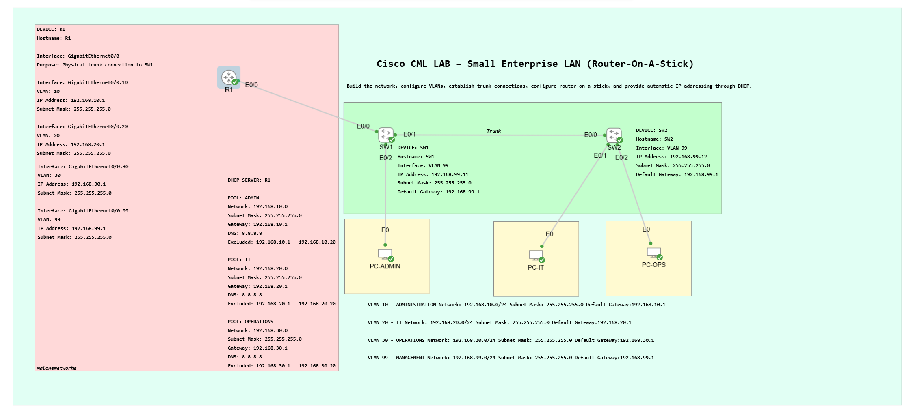

# Router-on-a-Stick | Cisco CML

A small enterprise network built in Cisco Modeling Labs.

## Topology

## What this lab covers

- VLANs and access ports
- 802.1Q trunking
- Router-on-a-stick inter-VLAN routing
- DHCP
- Switch management

## Network overview

| VLAN | Department | Network |
|---|---|---|
| 10 | Administration | 192.168.10.0/24 |
| 20 | IT | 192.168.20.0/24 |
| 30 | Operations | 192.168.30.0/24 |
| 99 | Management | 192.168.99.0/24 |

R1 provides the VLAN gateways and DHCP for the three department networks. SW1 and SW2 are managed through VLAN 99.

## Lab status

Core configuration is complete. Endpoint DHCP and inter-VLAN connectivity have been tested successfully. Documentation, screenshots, and final management connectivity checks will be added as the lab is reviewed.

## Repository contents

- `Topology/` – topology image and CML project file
- `Configurations/` – sanitized device configurations
- `Screenshots/` – lab verification screenshots
- `Documentation/` – step-by-step notes
